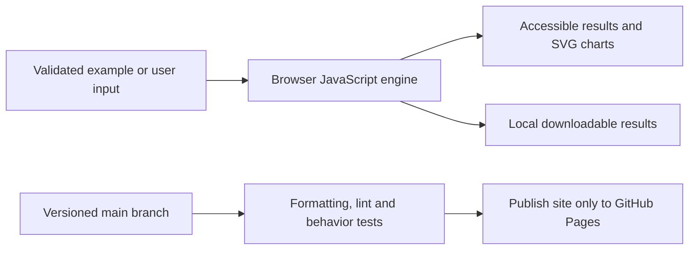

# Document API Playground

**Reproducible versions:** [Dependency versions and exact setup](DEPENDENCIES.md).


[Open the application](https://subhashdixit.github.io/document-api-playground/) · [Report an issue](https://github.com/subhashdixit/document-api-playground/issues)

The original MongoDB API inserted and listed a fixed schema without a maintained frontend. This release adds a complete document-CRUD interface, a clearly labelled local learning mode and an optional protected Flask/PyMongo backend.

## What the finished application does

- Create, edit, delete, filter and inspect bounded plain JSON documents.
- Use browser-only demo storage, with validated backup import/export.
- Explicitly connect to your own HTTPS backend with a tab-only access token.
- Preserve the original FastAPI/Motor learning source.

## Use the application step by step

1. Open the live application. Read the input labels and scope panel.
2. Start with the included example to understand the output.
3. Replace it with your own supported input. Files are processed locally unless you explicitly choose a server feature and consent to it.
4. Run the analysis and inspect the visual output together with its limitations.
5. Export your results when the tool offers a download. Keep your own copy; a browser tab is not a durable data store.

## Concepts, algorithms and interpretation

### Documents and CRUD

A document is a JSON object that may contain nested arrays/objects. CRUD means create, read, update and delete. Local mode stores a JSON collection in the browser; it is not a MongoDB server or an emulation of Mongo query operators. Server mode calls a separate Flask API that uses PyMongo against one owner-configured database/collection. IDs are application-generated UUID strings; the client cannot choose Mongo filters.

### Validation and boundaries

Reject Mongo operator keys ($ prefix), dotted field paths, reserved/prototype keys and excessive nesting. This is a deliberate constrained document schema, not full MongoDB feature parity. The backend uses exact `_id` equality and never passes user JSON as a query filter. A fixed bearer token grants owner-level access to the demonstration collection. It is not a multi-user identity system; use a dedicated collection and rotate/restrict credentials appropriately. Never embed that token or a Mongo URI in Pages files.

## Architecture and data flow



HTML provides the accessible page structure, CSS handles responsive layout, and ES modules separate calculation from user interaction. Pure calculation functions can run in Node tests without a browser. SVG charts scale with the screen; they use explicit axes, labels and legends. CSV exports escape spreadsheet formula prefixes in text cells.

The maintained backend source and its API/run/deployment instructions are in `backend/README.md`. Tests use an isolated in-memory store to exercise authentication and route behavior; real Mongo integration requires a dedicated test Mongo URI. The frontend always labels which store is active. No credentials are requested for local mode.

## Run locally from scratch

Install Node.js 22 and Python 3 for a local static HTTP server. Python is not a production backend for this app.

```bash
git clone https://github.com/subhashdixit/document-api-playground.git
cd document-api-playground
npm ci
npm test
npm run lint
npm run format
npm run check
python3 -m http.server 8000 --directory site
```

Open http://localhost:8000. Use HTTP rather than double-clicking HTML so that module imports and local data fetches work consistently. No production API secret belongs in `site/`.

## Coding structure

```text
site/
  index.html       # accessible application interface
  styles.css       # responsive design
  app.js           # interface orchestration
  engine.js        # validated calculations; no DOM dependency
  ui.js            # chart, CSV and download helpers
tests/             # behavior and boundary cases
.github/workflows/pages.yml
archive/           # original README and retired workflows where present
```

Original source files, notebooks and historical artifacts remain in the repository for comparison. The release publishes only `site/`; old source directories and datasets are not automatically exposed by the application.

## CI/CD and deployment

CI means continuous integration: each pull request and main-branch push installs exact lockfile dependencies, checks formatting, lints JavaScript, runs meaningful behavior tests and checks module syntax. A failed check stops publishing. CD means continuous deployment: after the required `Build and test` check succeeds on `main`, GitHub Actions uploads `site/` and GitHub Pages serves it over HTTPS.

The workflow uses pinned action revisions, minimal permissions and a protected main branch. Publishing jobs need Pages/OIDC permissions; test jobs only read source. Feature branches are deleted after merge. Static Pages hosting needs no always-running Python process, but cannot hide secrets, host a Flask process or provide durable server storage.

To set up a fork, enable GitHub Pages with **GitHub Actions** as its source and allow the repository's workflow to run. Repository Settings → Pages shows the deployment URL. If renaming the repository, update the README URL and any absolute links; application resources use relative paths. Check Actions logs if publishing fails.

### Release, monitoring and rollback

A commit identifies exactly which source was deployed. Inspect the Actions deployment and test results before sharing the link. After publishing, open the page, run its example and check exports; a successful HTTP response alone is not a functional test. For rollback, revert the faulty merge in a new PR, pass checks, and merge the revert. This triggers the same reproducible publishing process. Avoid force-pushing protected main or deleting history. Browser caches can retain an older asset briefly; refresh after a deployment.

### Docker and alternatives

Docker packages code and dependencies into a reproducible runtime. This static app does not require a container: Pages serves the same versioned files directly, with less operating work and no container cold starts. A container becomes useful if adding a Python backend; then secrets, patches, resource costs and persistent storage require separate management.

## Data provenance and attribution

Original mongodb_api source preserved. Maintained backend uses the official PyMongo driver and environment-only Mongo credentials. Fictional local examples contain no original database records.

## Practical limits

Local storage is unencrypted and browser-specific. Server mode is optional and requires owner-controlled MongoDB URI/access token; it is not claimed live without those settings and a real CRUD verification. The public Pages app is usable locally without them. Up to 500 documents, 30,000 characters per document, depth10 and 16 MiB imports. No transactions across arbitrary collections, full Mongo query language, row-level users or durable cloud-store guarantee.

The test suite checks calculation contracts and invalid inputs. It cannot establish that an input dataset is representative, that a heuristic is scientifically correct for every domain, or that a result is suitable for an automated consequential decision. Read the original source alongside the maintained browser implementation when comparing behavior.

## Local dependency installation

`requirements.txt` lists the complete supported production environment with exact `package==version` pins, including transitive dependencies. Use Python 3.11.17 in a fresh virtual environment:

```bash
python3.11 -m venv .venv
# Activate: source .venv/bin/activate (Windows: .venv\Scripts\activate)
python -m pip install -r requirements.txt
python -m pip check
```

For hash-verified installation and separate development environments, follow [DEPENDENCIES.md](DEPENDENCIES.md). Original prototype requirements are preserved at `archive/prototype-requirements.in` where present; they are not the supported install command.
